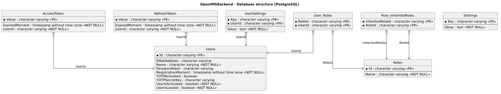

# Authentication

## Overview

A client of the OpenIMS-backend authenticates itself with an access-token which it receives by logging in.

## Endpoints

| Endpoint | Method | Authentication | Purpose |
| -------- | ------ | -------------- | ------- |
| `UserController/Login` | PUT | none | Exchanges username and password for an access-token. |
| `UserController/TokenIsValid` | GET | none | Answers whether a given access-token can still be used. |
| `UserController/Logout` | PUT | access-token | Invalidates the access-token of the current session. |
| `UserController/Register` | PUT | access-token, role `Administrators` | Creates a new user-account. |
| `UserController/GetUserInformation` | GET | access-token | Returns id, name and admin-flag of the caller. |
| `UserController/GetRoles` | PUT | access-token | Returns the roles of the caller. |
| `UserController/GetAllUsers` | GET | access-token, role `Administrators` | Returns all users with their roles. |
| `UserController/GetAllRoles` | GET | access-token, role `Administrators` | Returns the names of all assignable roles. |
| `UserController/SetRolesOfUser` | PUT | access-token, role `Administrators` | Sets the complete set of roles of a user. |
| `UserController/GetTheme` | GET | access-token | Returns the color-scheme the caller chose. |
| `UserController/SetTheme` | PUT | access-token | Stores the color-scheme of the caller. |

`Login` and `TokenIsValid` are the only two endpoints which are reachable without a valid access-token.
`Login` has to be, because it is what produces a token, and `TokenIsValid` has to be, because a client uses it to find out whether the token it still holds from an earlier session can be used at all.

## The login itself

The login is implemented in `BusinessLogicService.Login`, which delegates the credential-check to the authentication-service:

1. The configuration-value `LoginIsEnabled` is checked. If the login is disabled then the request is rejected regardless of the credentials.
2. The authentication-service looks up the user by its name.
3. The given password is hashed and compared with the stored hash.
4. An unknown user and a wrong password lead to exactly the same answer (401, "Invalid credentials"). This is intentional: a different answer would let a caller find out which usernames exist.
5. A locked account is rejected with its own message. At this point the caller already proved that it knows the password, so there is nothing left to reveal.
6. On success an access-token is created, stored in the table `AccessToken` and returned. It expires one day after it was created.

## The password

The password itself is never stored, only its SHA-256-hash (column `Users.PasswordHash`).
The hashing is done by `PersistentAuthenticationService.Hash`, which is also what the login uses to compare, so exactly one place decides how a password is hashed.

A user which is created for an external authentication-provider has no password at all; the column is nullable for that reason.

## Roles

Authorization is role-based and the required role is declared at the endpoint (`[Authorize(...)]`).

Two roles are created on the first start:

- `Users`: every user has it. It is the base-role of all users (`GetBaseRoleOfAllUser`).
- `Administrators`: it inherits `Users`, so an administrator passes a check for `Users` without having that role assigned explicitly.

A role can inherit other roles (table `Role_InheritedRoles`), and the inheritance is resolved when a user is loaded.
