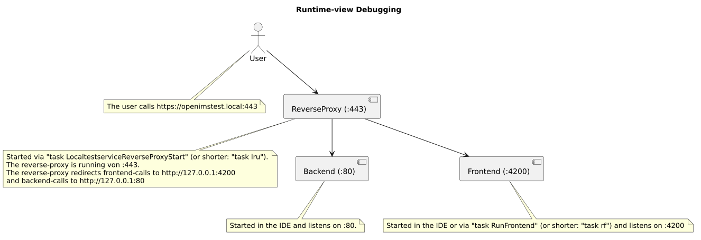
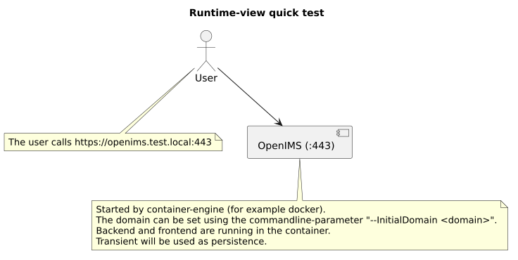
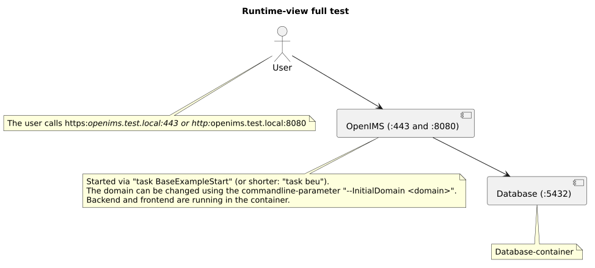
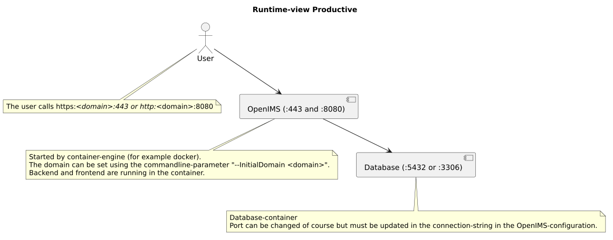

# 6. Runtime View

## Networking

### Debugging

When developing/debugging the following components are used usually:

### Testing

#### Quick test

For a quick test with a transient persistence `task BaseQuickStart` (or shorter: `task bqs`) is the correct command.
(Do `Ctrl+c` to abort the test.)
This starts OpenIMS locally in a container with a transient persistence:

#### Full test

For testing the entire app including a database-connection `task BaseExampleStart` (or shorter: `task beu`) is the correct command.
This starts OpenIMS locally in a container with a PostgreSQL-persistence:

### Productive

The productive runtime-view is very similar to the "Full test":

## Login

The login is the only runtime-scenario which crosses all three codeunits, so it is described here explicitly:

1. The user enters username and password into the login-form of the frontend.
2. The frontend calls `PUT /API/v0/UserController/Login` with both values as headers.
3. The backend hashes the password and compares the hash with the stored one of that user. An unknown user and a wrong password are answered identically (401), so the answer does not reveal whether the username exists.
4. On success the backend creates an access-token, stores it and returns it.
5. The frontend stores the token in the session-storage of the browser and sends it as the header `X-AccessToken` of every following request.
6. The token expires after one day. A logout removes it before that.

## Timezones

When running in containers then there is no system-timezone available anymore.
Until now there is no feature to pass a timezone into the container.
So in the container the log-timestamps are always in GMT+00:00 (UTC).
